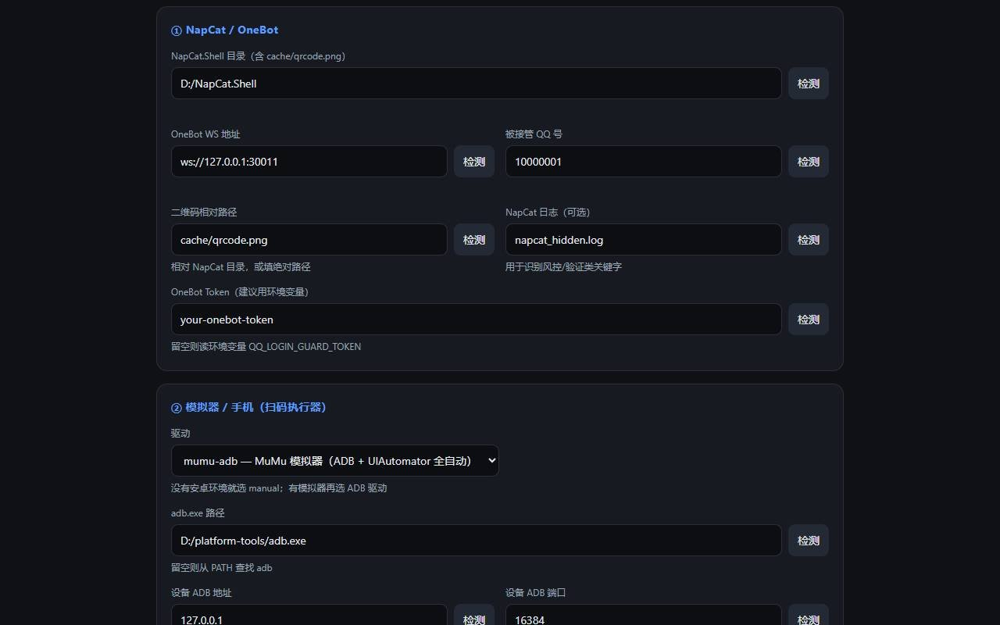

# qq-login-guard

[](https://github.com/banana770/qq-login-guard/actions/workflows/ci.yml)
[](LICENSE)
[](package.json)
[](docs/PROTOCOL_COMPAT.md)

> **给 NapCat 接管的真人 QQ 号做「掉线自愈」的旁路守护进程。**
> 检测掉线 → 让 NapCat 出二维码 → 驱动**安卓模拟器里的手机 QQ** 自动扫码登录 → 验证真的上线 → 失败则熔断并通知你。
>
> **不依赖任何 AI 框架**：AstrBot / NoneBot2 / MaiBot / LangBot / Koishi / DSH / 自研桥 / AI IDE 桥接……只要 QQ 号登在协议端上，都能用。
> **当前只适配 NapCat**（OneBot 11）。其它协议端（LLOneBot / SnowLuma / Lagrange）欢迎 PR 适配，见 [适配指南](docs/PROTOCOL_COMPAT.md)。

<p align="center">
  <a href="#-原理">原理</a> ·
  <a href="#-快速开始">快速开始</a> ·
  <a href="#-常见问题">FAQ</a> ·
  <a href="#-安全与合规必读">安全</a> ·
  <a href="docs/ARCHITECTURE.md">架构</a>
</p>

---

## 这是什么 / 不解决什么

| | 说明 |
|---|---|
| ✅ 解决 | **B 类**：用 [NapCat](https://github.com/NapNeko/NapCatQQ) 这类协议端登录**真人 QQ 号**，被腾讯风控踢下线后，自动重新扫码登录 |
| ❌ 不解决 | **A 类**：腾讯官方 QQ 机器人（QQ 开放平台 AppID/AppSecret）。它没有真人登录态，不存在"被踢下线"，不属本工具范围 |
| ❌ 不承诺 | 不承诺"防封/永久在线"；不自动处理短信验证码、滑块、申诉；不提供代扫/远程扫码服务 |
| ❌ 不做 | 不内置 AI 对话、不接消息、不换你的 AI 框架——它只在旁边维护"登录态"这一件事 |

> **它和 AI 框架的关系**：AI 框架（AstrBot 等）负责"收消息 → 调模型 → 回消息"；它负责"这个 QQ 号还登着吗，掉了就把它弄回来"。两者完全解耦：NapCat 掉线时 AI 框架本来也收不到消息，所以把自愈做在协议端这一层才对。

**为什么需要它**：NapCat 被风控踢下线后，自身不会自愈（实测会静默空转、不再出码），必须由外部程序重启/刷新二维码，再**由人拿手机扫码**。本工具把"人扫码"这一步交给模拟器里的手机 QQ 自动完成。

本机实测（连续多日）：账号被踢频率约 **每 1–2 小时一次**，人工扫码完全不可持续——这就是它存在的理由。

---

## 原理

```
                 ┌──────────────────────── qq-login-guard（旁路守护）────────────────────────┐
                 │                                                                          │
  NapCat  ──OneBot11 WS──▶  probe                 orchestrator                   notify   │──▶ Webhook / ntfy / 控制台
  (登着真人号)             · get_status 探活        · 状态机 + 归因                            │
                           · 假死探针(陌生人查询)    · 冷却/每小时重启上限/每日自愈上限         │
                           · 端口/进程/二维码/日志   · 单实例锁（防双头控制）                   │
                 │                │                                                          │
                 │                ▼                     qr / device / ui                     │
                 │        二维码来源(cache/qrcode.png)  · 600×600 放大留白（防相册过滤）          │
  安卓模拟器 ──ADB──▶  · push 到相册 + media scan（Android 10+ 秒级入库）                     │
  (手机 QQ 登着      · 打开 QQ → 扫一扫 → 相册 → 第一张 → 确定 → 授权按钮                     │
   同一个号)          · 事后【阅后即焚】删二维码                                               │
                 │                │                                                          │
                 │                ▼                                                          │
                 │         waitForOnline：真正恢复在线才算成功（不信"点完就好"）                 │
                 └──────────────────────────────────────────────────────────────────────────┘
```

**为什么必须由模拟器里的手机 QQ 来扫？**
NapCat 被踢后，重新登录需要一次扫码授权；而扫码端必须是"另一个已经登录该账号的设备"。模拟器里的手机 QQ 就是那个设备——而且它与 NapCat 同机同出口 IP，正好满足腾讯风控文案里"两台设备连同一网络"的建议。

**单实例锁 / 熔断**：被风控期间频繁重登会加重风控。所以工具会：
- 被踢几次才重启，重启有冷却与每小时上限；
- 自愈有每日上限；
- 识别到"被风控/需要短信验证/申诉"类日志时**立刻停手并通知**，绝不循环乱点。

完整设计见 [docs/ARCHITECTURE.md](docs/ARCHITECTURE.md)。

---

## 实机验证记录（2026-11-03）

**环境**：Windows 11 · MuMu 12（Android 12, 1080×1920）· 模拟器内手机 QQ 9.2.20 · NapCat（Windows）· Node 24

**结果**：从"检测到登录态损坏"到"恢复在线"**全程无人工操作**，约 46 秒：

| 时间 | 事件 |
|---|---|
| 18:07:19 | 检测到 `NAPCAT_NO_WS`（NapCat 进程在跑但 OneBot 端口未监听） |
| 18:07:21 | 按 PID 关停卡住的 NapCat → **VBS 隐藏窗口**重新拉起 |
| 18:07:23 | 新二维码生成（11s 内进入 `QR_WAITING`） |
| 18:07:34 | 推码入相册 → 打开手机 QQ → 扫一扫 → 相册 → 确定 |
| 18:08:03 | 评分选择器选中「登录」按钮（页面标题「登录确认」被正确排除） |
| 18:08:09 | `waitForOnline` 深度验证通过 → **ONLINE**（179ms） |
| 18:10:36 | AI 桥接自动重连：`已连接 NapCat OneBot WS` → `QQ 已登录` |

> 说明：本次为**人为制造**掉线（停掉旧守护并让 NapCat 退出），用于验证全自动链路；腾讯自然风控踢出的场景需长期观察（本项目默认会记录 `audit.jsonl`，可直接用于统计）。

---

## 快速开始

> **默认就是 MuMu 模拟器全自动扫码**：驱动预置 `mumu-adb`，`adb.exe` 路径留空会自动扫描 MuMu 安装目录（如 `...\MuMu Player 12\shell\adb.exe`）与 PATH。
> 没有安卓环境的用户才需要把驱动改成 `manual`（只通知）。安全起见首次仍建议先 `dry-run` 观察一轮，再切 `live`。

### 0. 你需要准备什么

| 必需 | 说明 |
|---|---|
| Windows 10/11（当前主要支持） | 必须有**桌面环境**和安卓模拟器 |
| Node.js ≥ 22 | https://nodejs.org/ （安装后命令行 `node -v` 能看到版本） |
| **NapCat.Shell** 且已登录你的 QQ 号 | 打开 OneBot v11 正向 WebSocket（默认 `ws://127.0.0.1:30011`） |
| **安卓模拟器 + 模拟器里的手机 QQ** | 推荐 MuMu 12；雷电/夜神也可（待实测）。模拟器里的手机 QQ **必须已登录同一个 QQ 号** |
| 电脑性能 | 模拟器常驻约占 2–4GB 内存 |

> ⚠️ 手机 QQ 与 NapCat 必须是**同一个 QQ 号**的两端：NapCat 负责协议端在线，模拟器里的手机 QQ 负责扫码授权。

### 1. 准备 NapCat（如果你还没有）

1. 下载 [NapCat.Shell](https://github.com/NapNeko/NapCatQQ/releases)，解压到任意目录；
2. 用 `launcher-user.bat <你的QQ号>` 启动（首次会出二维码，用手机 QQ 扫）；
3. 在 NapCat 的 OneBot 配置里开启**正向 WebSocket**，记下端口（默认 `30011`）和 token；
4. 确认 `http://127.0.0.1:<端口>` 能连（工具会自己探测 `get_status`）。

### 2. 准备模拟器 + 模拟器里的手机 QQ（关键）

1. 安装 MuMu 12（或其它安卓模拟器），启动一个实例；
2. 在模拟器里安装**手机 QQ**（应用中心或拖入 apk），登录**同一个 QQ 号**；
3. 确认模拟器**开了 ADB 调试**（MuMu：设置 → 其他 → ADB 调试；默认端口 `16384`）；
4. 在电脑上确认能连上：
   ```bat
   adb connect 127.0.0.1:16384
   adb devices
   ```
   > 没有 adb？下载 [platform-tools](https://developer.android.com/tools/releases/platform-tools)，或直接用你 NapCat 目录里附带的 `tools/adb/adb.exe`。

#### 「找不到模拟器里 QQ 的位置」怎么办？

工具需要知道两件事，别混淆：

| 字段 | 含义 | 怎么填 |
|---|---|---|
| **冷启动快捷方式** | 一个 Windows 快捷方式（.lnk）/程序，双击它 = **启动模拟器并进入模拟器里的那个手机 QQ** | 见下面两种做法 |
| **手机 QQ 包名 / 启动 Activity** | 模拟器里 QQ 这个 App 的标识 | 国服 QQ 默认 `com.tencent.mobileqq` / `com.tencent.mobileqq.activity.SplashActivity`，一般不用改 |

**做法 A（推荐）：在模拟器里给 QQ 创建桌面快捷方式**
1. 在模拟器桌面上**长按 QQ 图标** → 选择「创建桌面快捷方式 / 发送到桌面 / 添加到桌面」（不同模拟器菜单名不同，MuMu 一般长按即可看到）；
2. 快捷方式会出现在**电脑桌面**（或模拟器桌面）；
3. 右键 → 属性 → 复制「目标」里的路径（或者直接把 `.lnk` 文件拖到插件配置页的输入框里拿路径）；
4. 把这个 `.lnk` 路径填到配置页的 **「冷启动快捷方式」**。

**做法 B：直接选模拟器自带的启动器**
- 例如 MuMu 的 `MuMu模拟器.lnk`；这只会启动模拟器，QQ 由工具通过 ADB 自动拉起（`am start` 包名/Activity）。所以做法 B 也可用，只要确保启动的是**正确的实例**。

> 留空也可以：只要模拟器一直开着，工具就不需要冷启动。

### 3. 安装并打开配置页

1. 下载/解压本仓库；
2. 双击 **`0-打开配置页.bat`**（如果提示找不到 Node.js，先装 Node 22+）；
3. 浏览器自动打开 `http://127.0.0.1:39100/setup`，里面就是全部输入框：
   - NapCat 目录 / OneBot WS / QQ 号 / token
   - adb.exe 路径 / 设备地址端口 / 冷启动快捷方式 / QQ 包名 / 相册路径 / 分辨率
   - 策略（检查间隔、重启上限、自愈上限、冷却）
   - 通知（Webhook / ntfy）
4. 每填一个路径可点「检测」看 ✓/✗；最后点「保存配置」。



> 也可以在桌面创建快捷方式：双击 **`1-创建桌面快捷方式.bat`**，以后从桌面一键打开配置页。

### 4. 三条命令的冒烟顺序

```bat
:: ① 环境自检：路径 / ADB / OneBot / token / 端口
node src\cli.mjs doctor

:: ② 扫码链路空跑自检（不点击、不扫码）：ADB/设备/分辨率/手机QQ/UIAutomator/QQ主界面
node src\cli.mjs rehearse
node src\cli.mjs rehearse --launch

:: ③ 观察模式跑一段时间（掉线只记录、不动手）
node src\cli.mjs run --mode attach
```

确认 `rehearse` 全绿、观察模式里状态显示 `ONLINE` 后，再进入下一步。

### 5. 切到自动模式

先**停掉旧的守护**（如果你之前用别的方式守护 NapCat），然后：

```bat
:: 前台跑（看得见日志）
node src\cli.mjs run --mode attach --live
```

或直接双击 **`3-启动守护(LIVE自动扫码).bat`**（有二次确认）。

想开机自启：双击 **`4-安装开机自启.bat`**，按提示选择模式（详见下文）。

---

## 运行模式

### 三种 NapCat 关系模式

| 模式 | 行为 | 适合 |
|---|---|---|
| `attach`（默认） | 守护先起，等 NapCat 出现后接管；**不抢启动权** | 你已有自己的 NapCat 启动链 |
| `follow` | 只观察，**绝不拉起** NapCat | 只想监控 + 通知 |
| `embed` | 守护先起 → 由守护拉起 NapCat → 接管并负责重启 | **"随 NapCat 启动"推荐**：开机只启守护 |

### 后台静默

- 守护进程本身不创建窗口；
- 需要拉起 NapCat 时，Windows 下默认用 **VBS + wscript 隐藏窗口**启动（`launch.background=true`），不会弹黑色控制台；
- **桌面 QQ 客户端自己的登录窗口**属于 QQ 行为，工具默认不干预。如果它弹出并且你介意，可设 `launch.hideWindows=true`（**实验性**：会隐藏所有 `QQ.exe` 窗口，可能误隐藏你主号的窗口，慎用）；
- 模拟器/手机 QQ 的操作全部通过 ADB 完成，不会把模拟器窗口提到前台。

### 开机自启（Windows 计划任务）

双击 **`4-安装开机自启.bat`**：

| 选项 | 效果 |
|---|---|
| `1`（默认） | `run --mode attach`（dry-run，只观察） |
| `2` | `run --mode attach --live`（真自动扫码） |
| `3` | `run --mode embed`（由守护拉起 NapCat） |

- 任务名 `qq-login-guard`，登录后 30 秒自动启动，隐藏窗口；
- 卸载：双击 **`5-卸载开机自启.bat`**；
- 冲突保护：检测到旧的 `napcat-bridge-guard` 等任务会**中止**，避免"双头控制"（两边都重启 / 抢二维码）。先停旧的再装：
  ```bat
  schtasks /End    /TN napcat-bridge-guard
  schtasks /Change /TN napcat-bridge-guard /DISABLE
  ```

---

## 配置页字段说明

| 分组 | 字段 | 说明 |
|---|---|---|
| NapCat | NapCat.Shell 目录 | 含 `cache/qrcode.png` 的目录；用于找二维码、拉起、清理 |
| | OneBot WS 地址 | 例 `ws://127.0.0.1:30011` |
| | 被接管 QQ 号 | 用于假死探针（陌生人查询） |
| | 二维码相对路径 | 默认 `cache/qrcode.png`（相对 NapCat 目录） |
| | NapCat 日志 | 用于识别风控/验证类关键字（可选） |
| | OneBot Token | 建议留空、改用环境变量 `QQ_LOGIN_GUARD_TOKEN` |
| 设备 | 驱动 | **默认 `mumu-adb`（MuMu 全自动扫码）**；`generic-adb`=其它模拟器/真机；`manual`=只通知人工扫码（没有安卓环境才选） |
| | adb.exe 路径 | **留空会自动扫描 MuMu 安装目录与 PATH**；找不到再手填 |
| | 设备 ADB 地址/端口 | MuMu 默认 `127.0.0.1:16384`；雷电 5555；夜神 62001；逍遥 21503 |
| | **冷启动快捷方式** | 见上文「找不到模拟器里 QQ 的位置」 |
| | **手机 QQ 包名 / 启动 Activity** | 国服默认即可 |
| | 相册目标路径 | 模拟器内路径，默认 `/storage/emulated/0/DCIM/Camera/qr_fresh.png` |
| | 基准分辨率 | 默认 1080×1920，坐标会按 `wm size` 实际缩放 |
| 策略 | 检查间隔 / 连续离线几次触发重启 / 冷却 | 决定多快反应、多克制 |
| | 每小时最多重启 / 每日最多自愈 | 熔断上限，防止把账号从"被踢"推进"被封" |
| | 转人工后暂停 | 识别到风控/验证后停手多久 |
| | 模式 | `dry-run` / `live` |
| 通知 | Webhook URL | POST `{kind,text,at}` |
| | ntfy 主题/服务器 | 手机装 [ntfy](https://ntfy.sh) 订阅即可收推送 |

---

## 状态与排查

| 状态 | 含义 | 工具会做什么 |
|---|---|---|
| `ONLINE` | 一切正常（深度探针通过） | 什么都不做 |
| `SUSPECT_OFFLINE` | NapCat 自报在线但探测失败（幽灵在线） | 计入离线，达阈值后重启 |
| `LOGIN_INVALID` | OneBot 可达但登录态失效 | 重启 NapCat → 出码 → 自愈 |
| `QR_WAITING` | 有新鲜二维码 | 触发自动扫码 |
| `RISK_LIMITED` | 日志出现风控/限制登录 | **停手 + 通知**，等本人在手机 QQ 处理 |
| `VERIFY_REQUIRED` | 需要短信/设备锁/申诉 | **停手 + 通知** |
| `WS_HUNG` | 端口在但 OneBot 无响应 | 计入离线，达阈值后重启 |
| `NAPCAT_NO_WS` | NapCat 进程在跑但 OneBot 端口未监听（卡在登录/二维码已失效） | 计入离线，达阈值后**重启出码** |
| `NAPCAT_DOWN` | NapCat 没运行 | `launch.enabled` 时拉起（后台隐藏窗口）；否则通知 |
| `COOLDOWN` / `MANUAL_TAKEOVER` | 策略暂停中 | 等待 |

**常见问题**

| 症状 | 处理 |
|---|---|
| `rehearse` 报"设备不在线" | 模拟器没开 / ADB 端口不对 / 没 `adb connect`；先手动开模拟器，再跑 `rehearse` |
| `rehearse` 报"未找到包名" | 模拟器里没装手机 QQ，或包名填错（共存版包名不同） |
| `doctor` 报 token 失败 | NapCat 配了 token 但工具没拿到：填到配置里，或设置环境变量 `QQ_LOGIN_GUARD_TOKEN` |
| 自动扫码后仍离线 | 看 `.qq-login-guard/audit.jsonl`；常见原因：二维码过期（TTL 约 2 分钟）、手机 QQ 版本 UI 变化、账号被限制登录 |
| 配置页「二维码相对路径」显示 **✗ 不存在** | **正常**：账号在线时 NapCat 不会保留二维码文件，只有掉线/需要扫码时才生成。只要提示的是「暂无二维码文件（账号在线时正常）」即无需处理；若连**目录**都不存在才是路径填错 |
| 状态一直 `RISK_LIMITED` | 账号被腾讯限制了，**扫码也救不了**，需在手机 QQ 内按提示恢复/申诉；工具会暂停重试 |
| 两个守护互相抢 | 出现"双头控制"：只保留一个（停掉旧 `guard.mjs` 或其计划任务） |
| bat 报 `'nul' 不是内部或外部命令` | bat 被另存成了 UTF-8/LF；重新解压或用记事本另存为 ANSI |

---

## 兼容性

| 维度 | 支持情况 |
|---|---|
| 协议端 | **仅 NapCat**（OneBot v11，Windows）。其它协议端未适配 |
| 操作系统 | Windows 10/11（模拟器 + ADB 方案的前提） |
| 模拟器 | MuMu 12（已实测：1080×1920、手机 QQ 9.2.20）；雷电/夜神/逍遥逻辑上支持，**待实测** |
| 手机 QQ | 国服包名默认；UI 流程按现有版本验证，新版本可能需要调 UI 选择器 |
| AI 宿主 | **不需要**。任意宿主都能用；可选宿主壳见 [docs/ADAPTER.md](docs/ADAPTER.md) |
| Linux / 无模拟器环境 | 只能降级为"检测 + 通知"（`driver=manual`），不能自动扫码 |

### 欢迎适配其它协议端

当前只做了 NapCat，是因为它的二维码来源、日志、重启方式最明确。其它协议端的差异点在：

1. 二维码从哪来（文件路径 / WebUI API / 日志里的链接）；
2. 怎么拉起/重启协议端；
3. 日志里"被踢 / 风控 / 验证"的关键字；
4. 是否需要主动调用刷新二维码接口。

适配清单、代码接缝和验收标准见 **[docs/PROTOCOL_COMPAT.md](docs/PROTOCOL_COMPAT.md)**。欢迎 PR，新增一个协议端通常只需要一个配置预设 + 少量 probe/action 适配。

---

## 安全与合规（必读）

- **仅限本人自有账号、本人设备**。禁止用于他人账号、代扫、远程扫码（等于账号租借黑产）。
- **禁止**用于批量加好友、批量私聊、群发营销、引流、骚扰、诈骗等用途。
- 不自动处理短信验证码、滑块、申诉；检测到即停并通知。
- 二维码 = 账号控制权：本工具只在本机使用，二维码不落群、不外发；成功后立即销毁。
- 本工具**不保证降低风控、不承担封号后果**。腾讯风控是单方面自动处置，已有实测封禁案例；**不要用高价值主号测试**。
- NapCat 等协议端本身处于灰色地带，使用前请自行阅读并遵守腾讯相关服务条款（本项目不引用具体条款号）。
- 详细免责声明与禁止用途见 **[docs/COMPLIANCE.md](docs/COMPLIANCE.md)**。

**默认安全行为**：默认 `dry-run`（只观察）；按 PID 精准关停（绝不按镜像名杀 `QQ.exe`）；只删除本工具产生的文件；所有动作写审计日志。

---

## 开发与测试

```bash
# 单元测试（无需 NapCat/模拟器）
node test/state.test.mjs
node test/guard.test.mjs

# 本机自检
node src/cli.mjs doctor
node src/cli.mjs rehearse
```

（`npm test` 会起子进程跑 test runner；在受限沙箱里可能 `spawn EPERM`，直接 `node test/xxx.mjs` 即可。）

- 架构说明：[docs/ARCHITECTURE.md](docs/ARCHITECTURE.md)
- 宿主适配 ABI：[docs/ADAPTER.md](docs/ADAPTER.md)
- 协议端适配指南：[docs/PROTOCOL_COMPAT.md](docs/PROTOCOL_COMPAT.md)
- 贡献指南：[CONTRIBUTING.md](CONTRIBUTING.md)
- 安全策略：[SECURITY.md](SECURITY.md)

---

## 目录结构

```
qq-login-guard/
├── 0-打开配置页.bat              # 双击 = 起配置页 + 开浏览器
├── 1-创建桌面快捷方式.bat        # 双击 = 桌面生成「QQ登录守护-配置页」
├── 2-启动守护(dry-run观察).bat
├── 3-启动守护(LIVE自动扫码).bat
├── 4-安装开机自启.bat
├── 5-卸载开机自启.bat
├── 打开配置页.sh                 # macOS / Linux
├── src/
│   ├── cli.mjs              # init/setup/doctor/status/run/once/heal/rehearse
│   ├── orchestrator.mjs     # 主循环：探测→归因→决策→动作→审计
│   ├── probe.mjs            # OneBot 探活 / 假死探针 / 端口 / 二维码 / 日志
│   ├── state.mjs            # 状态机与归因
│   ├── store.mjs            # 计数持久化 + 熔断
│   ├── actions.mjs          # 按 PID 重启 NapCat / 拉起 / 验证在线
│   ├── drivers/             # manual（仅通知）/ adb（MuMu/通用模拟器/真机）
│   ├── image.mjs            # 二维码放大留白
│   ├── notify.mjs           # console / webhook / ntfy
│   ├── server.mjs           # /status /events /heal /api/* /setup
│   ├── setup.mjs            # 配置页（路径输入框 + 路径检测）
│   ├── doctor.mjs           # 环境自检
│   └── config.mjs           # 配置 schema / 路径解析
├── scripts/                 # 桌面快捷方式 / 开机自启
├── dsh-plugin/              # 可选：DeepSeek Harness 宿主壳（参考适配器）
├── docs/                    # 架构 / 适配 / 合规
├── test/                    # 单元测试
├── config.example.json
└── LICENSE
```

---

## License

[MIT](LICENSE)

> 本项目只做「本人账号的登录态恢复」，不做任何绕过风控、伪造设备或协议破解的功能。使用即表示你已阅读并同意 [docs/COMPLIANCE.md](docs/COMPLIANCE.md)。
