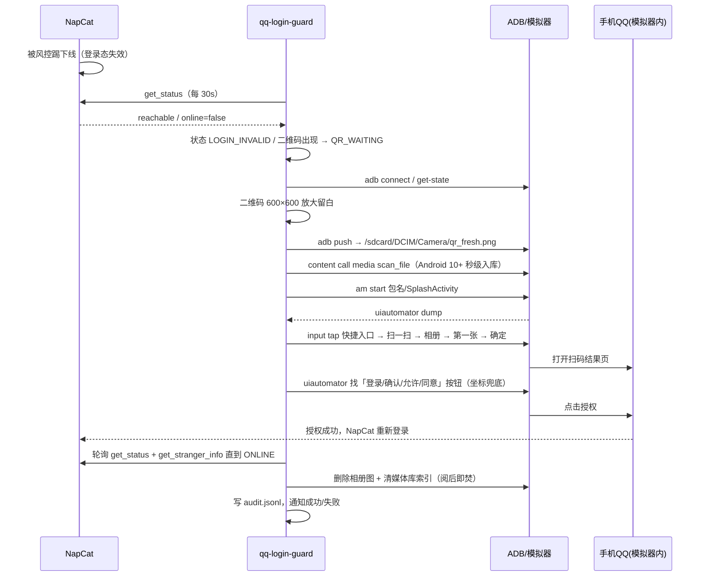

# 架构与原理

> 目标读者：想理解「为什么这么做」、或想改代码/加协议端的人。
> 一句话：**这是一个只做「登录态运维」的旁路进程，不碰消息、不碰 AI。**

---

## 1. 为什么是旁路（sidecar）而不是插件/内嵌

| 方案 | 问题 |
|---|---|
| 做进 NapCat 内部（插件） | 被踢后 NapCat 进程可能静默空转/不重启；插件跟着一起失效，且无法处理"进程挂了" |
| 做进 AI 框架（AstrBot 插件） | 框架挂了自愈就没了；且框架跑在 Linux 容器时没有安卓环境 |
| **旁路进程（本方案）** | 与 NapCat、AI 框架都解耦；NapCat 重启它不受影响；任何宿主都能用 |

所以核心是一个**独立 Node 进程**，通过 OneBot 11（只读探活 + 有限动作）与 NapCat 交互，通过 ADB 与安卓设备交互，通过本地 HTTP 暴露状态给宿主。

---

## 2. 总览

```
            ┌───────────────────────────── qq-login-guard ─────────────────────────────┐
            │                                                                         │
NapCat ─────┼─ OneBot11 WS ──▶ probe ──▶ state ──▶ orchestrator ──▶ actions ──▶ 进程/拉起 │
(登录真人号) │                       │                      │                           │
            │                       └─ 日志 tail / 端口 / 二维码                     │
            │                                              │                          │
            │                          qr / device / ui ◀──┘                          │
安卓设备 ◀──┼─ ADB: push 相册 / media scan / am start / uiautomator / input tap       │
(手机QQ同号) │                                                                         │
            │   notify（webhook/ntfy/console）   server（/status /events /heal /setup） │
            └─────────────────────────────────────────────────────────────────────────┘
                                          ▲
                                    宿主壳（可选）
                        DSH 插件 / AstrBot 插件 / NoneBot 插件 / 自研
```

### 2.1 模块职责

| 模块 | 文件 | 职责 | 副作用 |
|---|---|---|---|
| probe | `src/probe.mjs` | OneBot `get_status`、假死探针 `get_stranger_info`、TCP 端口、二维码文件 mtime/md5、日志 tail 关键字 | 只读 |
| state | `src/state.mjs` | 把探测结果归因为一个状态（含优先级：在线 > 风控/验证 > 登录失效/二维码 > 端口/进程 > 未知） | 纯函数 |
| store | `src/store.mjs` | 计数持久化（重启/自愈时间戳、连续离线次数、人工接管截止时间）+ 熔断门禁 | 写 JSON |
| orchestrator | `src/orchestrator.mjs` | 主循环：探测 → 归因 → 决策 → 动作 → 审计；单实例锁；状态服务 | 有 |
| actions | `src/actions.mjs` | 按 PID 重启 NapCat、拉起、等待上线 | 有 |
| drivers | `src/drivers/*` | 设备抽象：`manual`（只通知）/ `adb`（推码 + UIAutomator 扫码） | 有 |
| image | `src/image.mjs` | 二维码放大到 600×600 + 白边（NearestNeighbor），替代原 PowerShell 内联脚本 | 写临时图 |
| notify | `src/notify.mjs` | console / webhook / ntfy | 网络 |
| server | `src/server.mjs` | 本地 HTTP API + 配置页；默认只绑 127.0.0.1 | 监听 |
| setup | `src/setup.mjs` | 配置页 HTML + 路径检测 | 无 |
| doctor | `src/doctor.mjs` | 环境自检 | 只读 |
| config | `src/config.mjs` | 配置 schema/默认值/路径解析/token 解析 | 只读 |

---

## 3. 状态机（核心设计）

```
                     ┌──────────┐
      深度探针通过 ──▶ │  ONLINE  │
                     └────┬─────┘
        get_status 乐观但探针失败 │
                     ┌──────────▼─────────┐
                     │  SUSPECT_OFFLINE   │──连续 N 次──▶ 重启 NapCat
                     └────────────────────┘
   日志命中风控/限制登录 ──▶ RISK_LIMITED ──▶ 停手 + 通知（人工）
   日志命中验证/设备锁  ──▶ VERIFY_REQUIRED ──▶ 停手 + 通知（人工）
   OneBot 可达但 offline ──▶ LOGIN_INVALID ──▶ 重启 NapCat → 出码
   存在新鲜二维码       ──▶ QR_WAITING    ──▶ 自动扫码自愈
   端口在但 OneBot 无响应 ──▶ WS_HUNG      ──▶ 计入离线 → 重启
   进程不在且端口不在     ──▶ NAPCAT_DOWN  ──▶ embed 模式拉起 / 否则通知
   证据不足             ──▶ UNKNOWN      ──▶ 不动（宁可不动，不瞎重启）
```

**为什么状态这么分？** 因为「被踢」有很多种，处理方式完全不同：

- **被踢后 NapCat 还能自己出码** → 只需扫码（`QR_WAITING`）
- **被踢后 NapCat 静默空转、不出码**（实测 issue）→ 必须重启进程（`LOGIN_INVALID`/`WS_HUNG`）
- **被风控限制登录 / 要短信验证** → 扫码也没用，重试只会加重风控 → `RISK_LIMITED`/`VERIFY_REQUIRED`，**必须停手并通知人**
- **NapCat 假死（自报 online 但实际掉线）** → 用 `get_stranger_info` 深度探针识别，不能只信 `get_status`

`UNKNOWN` 故意"什么都不做"：证据不足时重启是危险的（会把一个正在登录的过程打断）。

---

## 4. 一次自愈的时序



关键点：**"点击完成"不等于成功**。必须等 OneBot 真恢复在线（且深度探针通过）才记成功；失败会通知并按策略退避。

---

## 5. 熔断与安全设计

| 机制 | 目的 |
|---|---|
| 单实例锁 `guard.lock` | 防止两个守护同时重启 NapCat / 抢同一张二维码（双头控制） |
| 连续离线计数 + 冷却 + 每小时重启上限 | 防止"5 分钟一重启"式的狂暴重试（实测会加重风控） |
| 每日自愈上限 | 防止无人值守时无限扫码 |
| 风控/验证状态立即停手 | 不循环乱点、不自动过短信/滑块/申诉 |
| 默认 dry-run | 首次运行只观察，避免误动作 |
| 按 PID 精准关停 | 先找端口持有者 PID 再 `taskkill /T /PID`，**绝不 `taskkill /IM QQ.exe`**（会杀用户主号） |
| 最小删除集 | 只删本工具 push 的 `qr_fresh.png` 和本地临时图，**不做相册通配符清空** |
| 审计 | `.qq-login-guard/audit.jsonl`，token 自动脱敏 |

---

## 6. 为什么宿主无关

核心只依赖三样东西：OneBot 11 接口、本地文件、ADB。AI 框架与它没有任何代码/进程依赖。

- 宿主想展示状态 → `GET /status`
- 宿主想给"一键恢复"按钮 → `POST /heal`
- 宿主想托管进程 → 起/停 `node src/cli.mjs run`
- 宿主想内嵌配置页 → 打开 `http://127.0.0.1:39100/setup`

接口约定见 [ADAPTER.md](ADAPTER.md)。DSH 插件 `dsh-plugin/` 是一个 ~250 行的参考实现。

---

## 7. 当前限制（诚实清单）

1. **只适配 NapCat**：二维码来源/日志/重启方式都按 NapCat 写死（可在 `config`/`probe`/`actions` 加预设扩展，见 [PROTOCOL_COMPAT.md](PROTOCOL_COMPAT.md)）。
2. **ADB 驱动只验证到 MuMu + 手机 QQ 9.2.20**：完整扫码流程（推码→点击→授权）尚未在所有版本/模拟器上回归。
3. **Windows 为主**：模拟器 + ADB + 计划任务都是 Windows 形态；Linux 只能通知模式。
4. **不处理账号级处置**：被限制登录/需要申诉时只能停手通知。
5. **不保证自愈率**：取决于二维码 TTL、手机 QQ UI 版本、模拟器响应速度。
